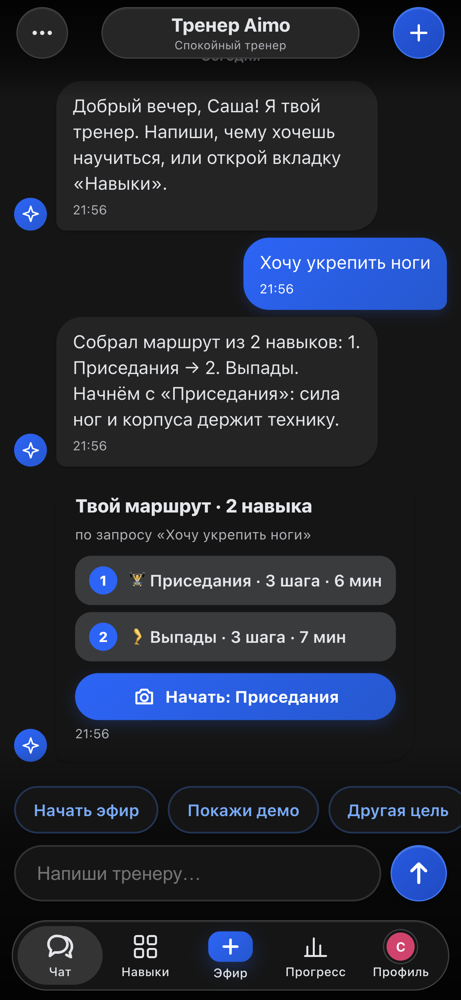
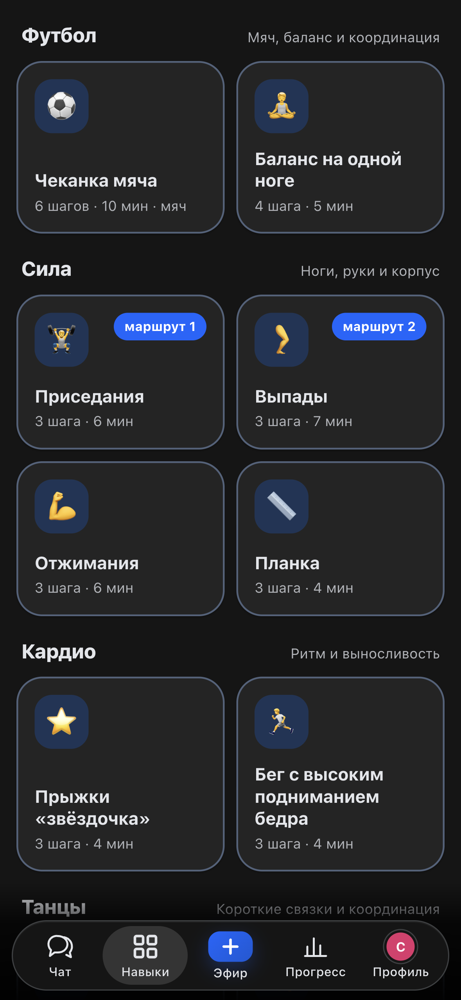
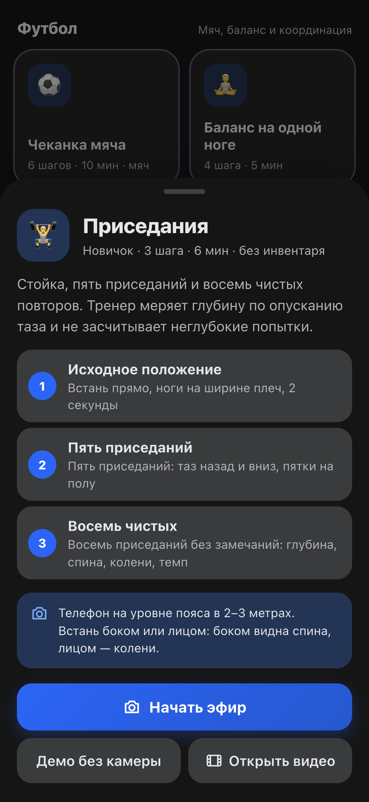
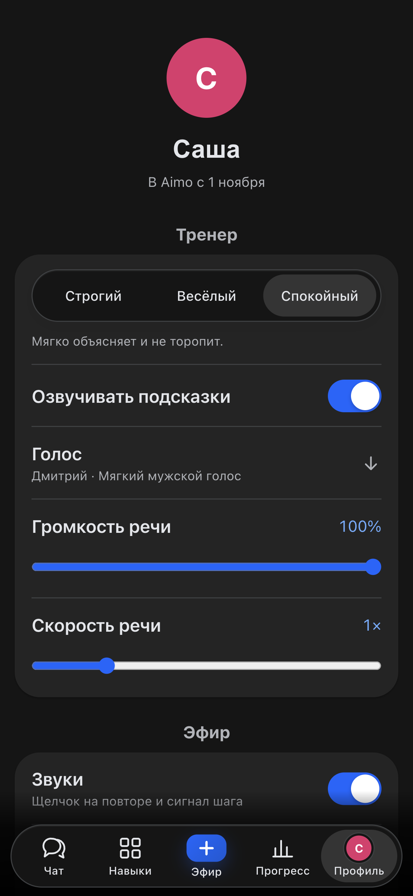

# Aimo — тренер на устройстве

Aimo помогает новичку освоить движение через камеру телефона. Чат подбирает
навык, тренер считает наблюдаемые движения, объясняет ошибки и сохраняет итог
локально. Десять навыков: чеканка, баланс, приседания, выпады, отжимания,
планка, «звёздочка», высокие колени, «Танцы Тикток» и «Трендовые танцы». Интерфейс на русском.

[Открыть приложение](https://nomad-dreamteam.github.io/Aimo/) ·
[План развития](docs/FEATURE_ROADMAP.md) · [Приёмка](docs/TEST_PLAN.md)

Развиваем продукт и готовим его к следующему этапу. Материалы предыдущего
конкурса сохранены в [архиве](docs/archive/2026-vibehack/README.md);
их критерии и веса не определяют текущие задачи.
Разработчики: [Raistaid](https://github.com/Raistaid) и [meazuk1](https://github.com/meazuk1).

## Экраны приложения

Текущий интерфейс в тёмной теме на мобильном экране 393 × 852.

| Чат с тренером | Каталог навыков |
| :---: | :---: |
|  |  |
| Маршрут по цели «Хочу укрепить ноги». | Десять навыков в четырёх разделах. |

| Карточка упражнения | Профиль и голос |
| :---: | :---: |
|  |  |
| Шаги урока и подсказка по установке телефона. | Характер тренера, голос и настройки речи. |

## Попробовать

1. Открой приложение и создай локальный профиль.
2. Напиши цель в чате или выбери навык в каталоге.
3. Поставь телефон устойчиво, запусти эфир и разреши камеру.
4. Следуй шагам, поставь эфир на паузу или заверши; итог появится в чате.

Камера запускается явным действием. Без неё доступно помеченное демо,
которое не записывается в историю. Можно разобрать выбранный локальный видеофайл.

## Как работает

- MediaPipe оценивает позу и детектирует предметы на устройстве. Только класс
  sports ball участвует в подсчёте касаний. Без мяча показываются подъёмы стопы.
- Чистые правила навыков определяют повторы, удержания, ошибки и шаги урока.
  Бюджет сообщений и очередь голоса ограничивают частоту подсказок.
- Необязательная Qwen через WebLLM работает локально в worker при наличии WebGPU.
  Сначала скачивается модель, затем используется в чате и эфире. Ответ проверяется кодом.
- Голоса Piper скачиваются по выбору; при сбое используется голос браузера.
  Источники и лицензии: [THIRD_PARTY.md](docs/THIRD_PARTY.md).
- Пользовательский ввод, профиль и история не становятся системными инструкциями.
  Вывод модели проверяется до показа и озвучивания. Подробнее: [SECURITY.md](docs/SECURITY.md).
- Удаление переписки, прогресса и скачанных моделей/голосов требует подтверждения.
  Локальные профили кодирующих агентов проверяются `npm run check:permissions`;
  выбор отдельной сессии и ограничения среды описаны в [SECURITY.md](docs/SECURITY.md).

Видео не записывается и не отправляется. Для речи Piper текст остаётся на устройстве.
Распознавание голосового вопроса может передавать аудио сервису браузера;
предупреждение показано у микрофона. История до 50 тренировок и чаты сохраняются локально.

## Структура

```text
src/
  app/        интерфейс, камера, звук, локальные данные и интеграция
  coach/      зрение, правила движений, подсказки и прогресс
  ai/         локальная модель, промпты и защита ввода/вывода
  skills/     каталог и проверяемые измерения навыков
  shared/     общие чистые функции
  styles.css
assets/icons/ исходник и размеры иконки
tests/        проверки по областям app, coach, ai, offline
scripts/      сборка и проверки
docs/         актуальные документы; архив отдельно в docs/archive/
index.html, sw.js, manifest.webmanifest
```

Полная карта и контракты: [ARCHITECTURE.md](docs/ARCHITECTURE.md).
`dist/` создаётся сборкой и содержит только файлы приложения; тесты,
документы, архивы и инструкции агентов в публикацию не входят.

## Разработка

Нужны Python 3 и Node.js 22+. У приложения нет npm-зависимостей.

```sh
npm run dev               # http://127.0.0.1:4173
npm run test:app           # камера, звук, хранилище, UI-вспомогательные функции
npm run test:coach         # движения, мяч, навыки и правила
npm run test:ai            # промпты, маршруты, валидация
npm run test:security      # атаки и обычные запросы
npm run test:offline       # service worker
npm run check             # синтаксис → все тесты → сборка → проверка пакета
```

Для браузерной приёмки отдельно установи Playwright и Chromium, запусти
локальный сервер и `npm run check:browser`. `AIMO_BASE_URL` меняет адрес,
`AIMO_PLAYWRIGHT_MODULE` — путь к модулю Playwright,
`AIMO_BROWSER_EXECUTABLE` — путь к браузеру. Для готового пакета используй
`AIMO_BASE_URL=http://127.0.0.1:4173/dist/`. Камера и модель в автоматической
приёмке имитируются; проверка реального устройства описана в [TEST_PLAN.md](docs/TEST_PLAN.md).

Иконки: `swift scripts/render-icon.swift` на macOS; исходник и промпт находятся в `assets/icons/`.
CI проверяет ветки и pull request. Публикация GitHub Pages идёт из `main` после проверок.

## Работа с агентами

Начни с [AGENTS.md](AGENTS.md). В `.codex/agents/` определены frontend,
vision, coach_llm, qa и feature_developer. Каждая роль получает область файлов,
профильные тесты и общий контракт от root. Настройки не меняют выбранные модели;
одновременно допускается до трёх задач. Делегирование — по явному поручению.
Архивные журналы не входят в обязательное чтение.

## Ограничения

Точность зависит от света, ракурса и устройства. Ориентиры тела не заменяют
полную экспертную оценку техники. Цель 8 к/с на телефоне требует реального
измерения. Установленная оболочка и демо работают офлайн; для зрения нужны
заранее закешированные модели, для Qwen — WebGPU и память устройства.
Фильтры и разделение промптов уменьшают риск инъекций, но не гарантируют
следование инструкциям моделью. Отдельного сервера, трансляции зрителям и
доступа LLM к инструментам нет.
